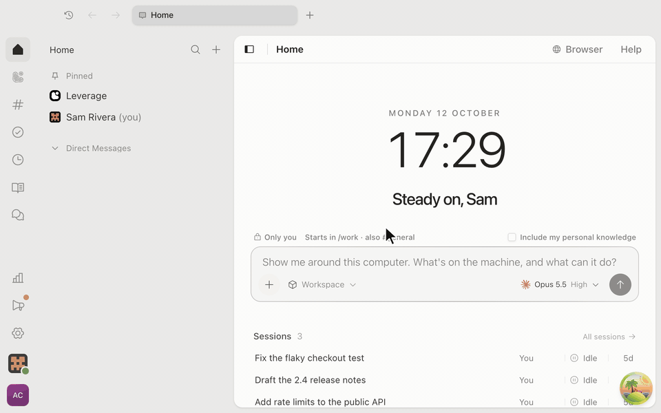

# <picture><source media="(prefers-color-scheme: dark)" srcset="docs/leverage-dark.svg"></picture> OpenCode on Leverage

<a href="https://leverage.computer/integrations/#opencode"></a>
<a href="#features"></a>
<a href="#desktop"></a>

[Features](#features) · [Desktop](#desktop) · [Terminal](#terminal) ·
[Other clients](#other-opencode-clients) · [leverage.computer](https://leverage.computer)

[](docs/desktop.mp4)

## Features

- **Multiplayer harness**: each prompt shows who sent it, and a teammate's
  prompt appears as soon as they send it.
- **Company computer**: sessions run in Leverage's sandbox and are shared with
  your team. Leverage serves OpenCode's HTTP API, so nothing runs on your
  machine.
- **Steering**: your prompt shows at once and steers a running turn. Prompts
  sent while it is busy wait in a queue you can list, take back or send now.
- **Governance**: the agent asks you to pick an option, approve a plan, or
  allow a call: once, for the session, or always.

Each space shows as a folder.

## Desktop

In the Leverage desktop app, open Settings → Developer tools and click
**Sync into OpenCode**. If OpenCode is open, it closes and opens again with the
workspace.

From a terminal instead:

```sh
leverage opencode setup
```

Mac only, OpenCode Desktop 2.0.15 or later. Sync again after you change spaces
in Settings. OpenCode Desktop holds one workspace at a time.

## Terminal

```sh
leverage opencode engineering
```

With no space, it opens the whole workspace.

[](docs/terminal.mp4)

## Other OpenCode clients

Make a token in Settings → Developer tools → OpenCode, then connect with:

- Server: `https://app.leverage.computer/api/opencode[/<space>]`
- Password: your token

## The Leverage CLI

The terminal commands need the Leverage CLI. In the Leverage app, Settings →
Developer tools → CLI gives its install command, for macOS and Linux.

A session you start from OpenCode is private until you share it.
